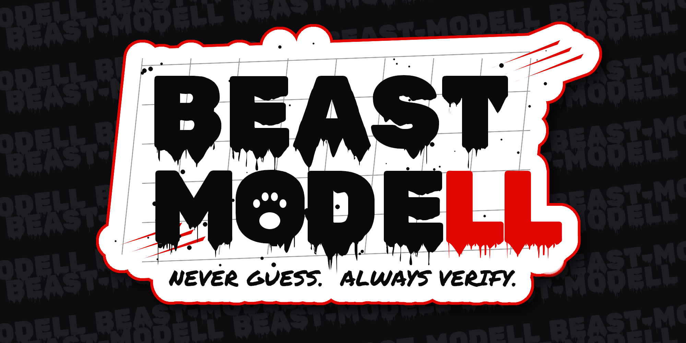

<p align="center">
  
</p>

# Beast-ModeLL

<p align="center"><b>Golden Rulez. Verified evidence. Durable context. Fresh answers.</b></p>

Beast-ModeLL is a portable agent skill: a brain, a process, and a memory habit that any agent can load. It keeps agents on point by refusing to guess, working from verified sources, and keeping a ledger so recurring questions get faster and stay current.

## Golden Rulez

1. Never guess, assume, or hallucinate. Never invent facts, sources, results, or completed work.
2. Work from real intent, real logic, and real thought process.
3. Use verified sources and verified processes. Label what is verified, estimated, inferred, or unknown.
4. Surface questions, issues, failures, and enhancements. The user is here to guide.
5. Remember questions, comments, feedback, and decisions so every agent gets sharper over time.
6. Reuse the method for a recurring question; refresh the numbers every time.

## How it works

Every task runs the same loop: **intent → ledger → evidence → freshness → reason → validate → retain.** The full procedure is in [`skills/beast-modell/SKILL.md`](skills/beast-modell/SKILL.md).

Memory lives in a **ledger** inside each project that uses the skill (a `.beast-modell/` folder), never in this repo. Each project keeps its own memory, so nothing bleeds across projects. Ledger rules: [`references/ledger.md`](skills/beast-modell/references/ledger.md).

**Recurring-question example:** the first time someone asks "what were sales last month?", the agent confirms the definition and source, answers, and saves the recipe. Next time it reuses the recipe, re-runs it against the live source, and compares with the last dated observation. It never repeats an old number as current.

## Install

One skill, four hosts. All use the open [Agent Skills](https://agentskills.io/specification) `SKILL.md` format.

| Agent | Guide |
|---|---|
| Perplexity Computer | [install/perplexity.md](install/perplexity.md) |
| Claude (Code and Claude.ai) | [install/claude.md](install/claude.md) |
| Replit Agent | [install/replit.md](install/replit.md) |
| OpenClaw | [install/openclaw.md](install/openclaw.md) |

```bash
python3 scripts/validate.py   # checks SKILL.md against the spec
./scripts/package.sh          # builds dist/beast-modell.zip for upload
```

## Repo layout

```
skills/beast-modell/      the skill (SKILL.md, references/, assets/ledger/ templates)
install/                  per-agent install guides
scripts/                  validate and package
assets/logo/              logo (GIMP source + PNGs)
AGENTS.md                 contract for agents editing this repo
```

## Status

The skill, ledger templates, validator, and packager are built and checked. Installing the skill into a specific agent is a separate step per host. An agent follows Beast-ModeLL only after the skill is installed there and confirmed loaded.
